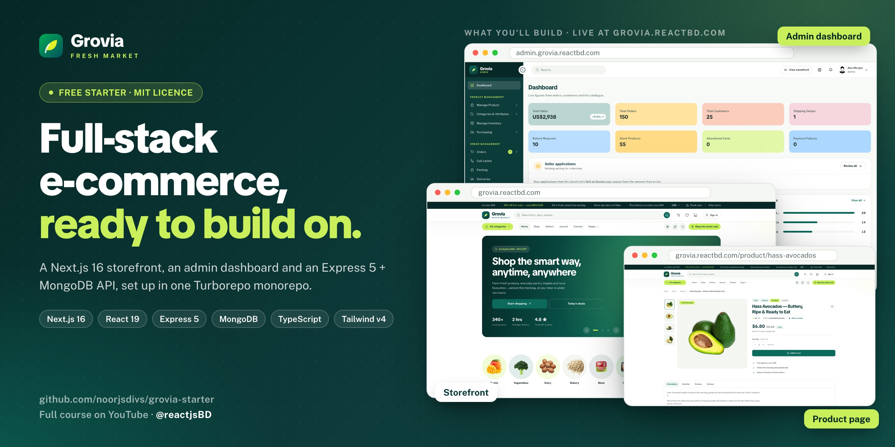
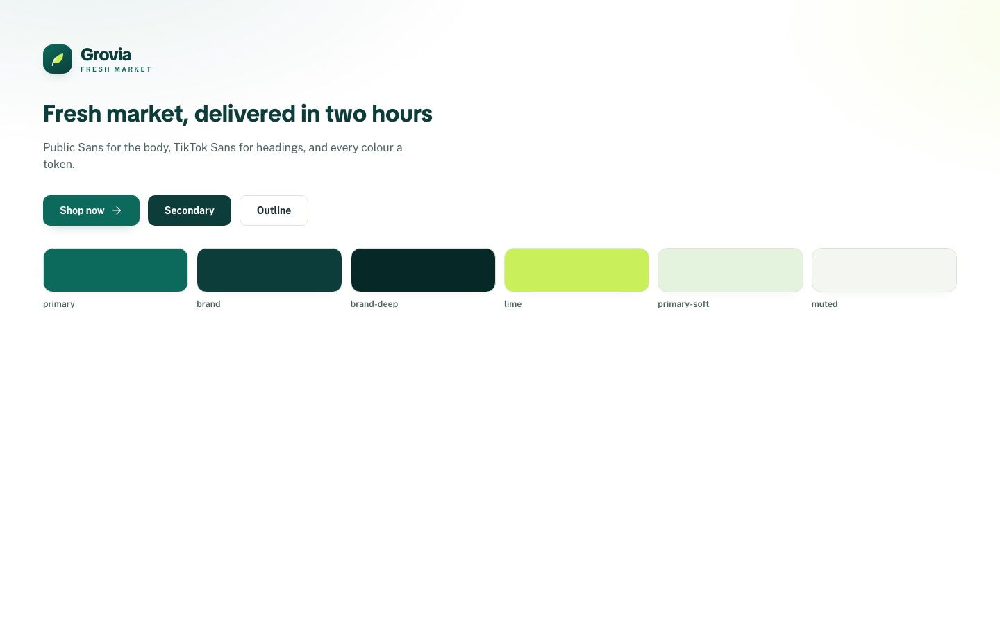
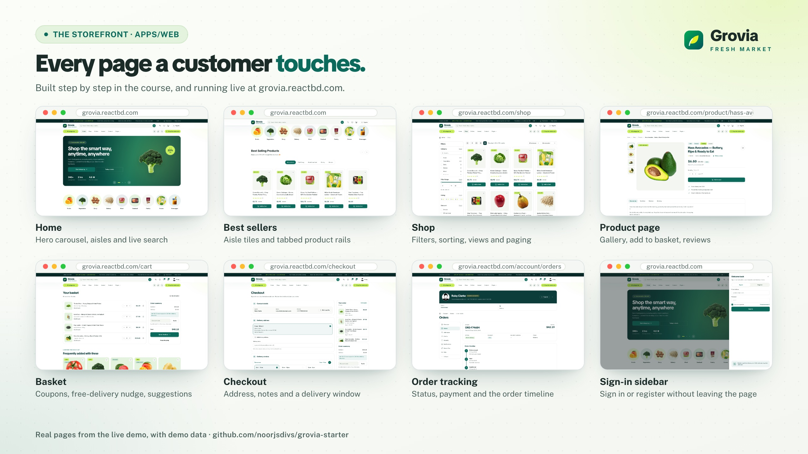
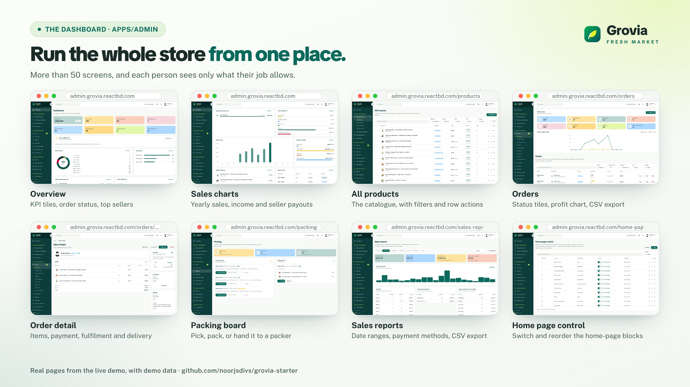

<div align="center">



# Grovia Starter

**Full-stack fresh-market e-commerce: the starting point.**
A Next.js 16 storefront, a Next.js 16 admin dashboard and an Express 5 + MongoDB REST API in one Turborepo monorepo, set up and ready for you to build on.

[](https://nextjs.org)
[](https://react.dev)
[](https://expressjs.com)
[](https://mongoosejs.com)
[](https://www.typescriptlang.org)
[](https://tailwindcss.com)
[](https://turborepo.com)
[](./LICENSE)

[**Live storefront**](https://grovia.reactbd.com) · [**Live dashboard**](https://admin.grovia.reactbd.com) · [**Docs**](https://docs.grovia.reactbd.com) · [**YouTube course**](https://www.youtube.com/@reactjsBD) · [**Get the full version**](https://buymeacoffee.com/reactbd/e/579772)

</div>

---

## What this repository is

This is the free companion repo for the **Grovia from scratch** course on the [ReactJS BD YouTube channel](https://www.youtube.com/@reactjsBD). The course builds the whole Grovia platform from an empty folder. This repo gives you the finished groundwork, so you can start writing features straight away:

- **The monorepo is done:** pnpm workspaces, the Turborepo pipeline, one root `.env`, strict TypeScript everywhere, and a setup script.
- **Each app is at the end of its "Foundation" chapter.** It installs, builds, lints, type-checks and runs, with nothing missing and nothing stubbed.
- **The asset pack is included:** 50 product, editorial, people and promo photos, plus the seed data the course loads into MongoDB.

Everything after the foundations is what the course teaches you to build. If you'd rather start from the end, the [complete Grovia source](#get-the-full-version) is available as a one-time purchase.

| | |
| :-- | :-- |
|  | **What you get after `pnpm run dev`:** the storefront on the real design system (Public Sans and TikTok Sans, every colour a semantic token, shadcn/ui restyled onto those tokens), the dashboard on the same tokens, and an API that answers `/api/health` with a request id on every response. |

---

## Live demo

The finished product runs in production:

| App | URL |
| :-- | :-- |
| Storefront | **https://grovia.reactbd.com** |
| Admin dashboard and seller portal | **https://admin.grovia.reactbd.com** (staff sign-in) |
| Documentation site | **https://docs.grovia.reactbd.com** |

### What you'll build





---

## Starter vs. the full version

| | This starter (free, MIT) | [Full Grovia](https://buymeacoffee.com/reactbd/e/579772) |
| :-- | :-: | :-: |
| Turborepo + pnpm monorepo, one root `.env`, setup script | ✅ | ✅ |
| Strict TypeScript, ESLint and Vitest in every app | ✅ | ✅ |
| **API:** Express 5, MongoDB connection with retry, request ids, readiness gate, one JSON error envelope, `/api/health`, graceful shutdown | ✅ | ✅ |
| **Storefront and dashboard:** Next.js 16 App Router, the full design-token stylesheet, the shadcn/ui primitives, logo, fonts, root layouts | ✅ | ✅ |
| Asset pack: product photos and seed data | ✅ | ✅ |
| 60+ Mongoose models, 70+ route modules, Swagger docs | | ✅ |
| Sign-in with email (verified), Google, Facebook, GitHub, X and LinkedIn; JWT in httpOnly cookies | | ✅ |
| Storefront: home page built from blocks, shop, filters, products sold by unit or weight, basket, wishlist, compare | | ✅ |
| Checkout: guest or account, coupons, delivery windows booked against capacity, Stripe or cash on delivery | | ✅ |
| Order tracking, customer account, returns, notifications, journal, seller shops, legal pages, SEO and JSON-LD | | ✅ |
| Dashboard with 50+ screens: catalogue, orders, call centre, packing, deliveries, cash desk, ledger, reports, CMS, settings | | ✅ |
| Seller marketplace: applications, seller portal, commission, payouts and withdrawals | | ✅ |
| Background jobs (BullMQ), email touchpoints, Stripe refunds that run exactly once, low-stock alerts | | ✅ |
| One-command demo store (55 products, 35 categories, 3 shops, 16 posts), Jest, Vitest and Playwright tests, deployment guide, docs site | | ✅ |

---

## Quick start

### Prerequisites

| Tool | Version | Notes |
| :-- | :-- | :-- |
| [Node.js](https://nodejs.org) | **22** (20.9 or newer) | `.nvmrc` pins 22, so `nvm use` picks it up |
| [pnpm](https://pnpm.io) | **11** | `corepack enable pnpm`, or `npm install -g pnpm@11` |
| [MongoDB](https://www.mongodb.com) | 7 or newer | Local, Docker, or a free [Atlas](https://www.mongodb.com/cloud/atlas/register) cluster |
| Git | any | |

### 1. Clone

```bash
git clone https://github.com/noorjsdivs/grovia-starter.git
cd grovia-starter
```

### 2. Set up

**Automatic (recommended):**

```bash
node setup.mjs
```

It checks your Node version, makes sure pnpm is available, runs `pnpm install`, creates `.env` from `_.env.example`, asks for your MongoDB connection string, and writes a random `JWT_SECRET`. Add `--yes` to accept every default.

**Manual:**

```bash
pnpm install
cp _.env.example .env          # Windows (PowerShell): Copy-Item _.env.example .env
openssl rand -base64 32        # paste the output into JWT_SECRET in .env
```

Then set `MONGO_URI` in `.env`.

### 3. Run

```bash
pnpm run dev
```

| App | URL | What you should see |
| :-- | :-- | :-- |
| Storefront | http://localhost:3000 | The Grovia logo, buttons and colour swatches |
| Dashboard | http://localhost:3001 | The "Dashboard" page header |
| API | http://localhost:8000/api/health | `{"ok":true,"status":"healthy","db":"connected",…}` |

If the API answers `503` with `"db":"disconnected"`, it is running but can't reach MongoDB. See [Troubleshooting](#troubleshooting).

The step-by-step guide, including MongoDB on macOS, Windows, Linux, Docker and Atlas, is in **[SETUP.md](./SETUP.md)**.

---

## Project structure

```text
grovia-starter/
├── apps/
│   ├── api/                      Express 5 REST API              → :8000
│   │   ├── config/
│   │   │   ├── env.ts            finds and loads the one root .env, checks required keys
│   │   │   └── db.ts             MongoDB connection that keeps retrying
│   │   ├── middleware/
│   │   │   ├── errorMiddleware.ts      one JSON error envelope + JSON 404s
│   │   │   ├── readinessMiddleware.ts  503 while the DB is down, request timeout
│   │   │   └── requestIdMiddleware.ts  X-Request-Id on every response
│   │   ├── data/grovia/          asset pack: seed content, image manifest, gallery
│   │   └── server.ts             helmet, CORS, compression, /api/health, graceful shutdown
│   ├── web/                      Next.js 16 storefront           → :3000
│   │   ├── public/images/        asset pack: products, journal, people, shops…
│   │   └── src/
│   │       ├── app/              globals.css (every design token), layout, (storefront)/page
│   │       ├── components/ui/    shadcn/ui primitives restyled onto the tokens, Icon set
│   │       ├── components/       Logo, SiteSettingsProvider
│   │       └── lib/utils.ts      cn() and small helpers (+ tests)
│   └── admin/                    Next.js 16 dashboard            → :3001
│       └── src/
│           ├── app/              globals.css (same tokens + KPI palette), layout, (dashboard)/page
│           ├── components/ui/    primitives + Drawer, ConfirmDialog, DatePicker, TableFilters…
│           └── lib/              utils, pagination, list-query, recover, observability (+ tests)
├── packages/                     reserved for shared packages
├── _.env.example                 the one environment template (copy to .env)
├── setup.mjs                     first-run setup
├── turbo.json                    the task pipeline
├── pnpm-workspace.yaml           workspaces + allowed install scripts
└── package.json                  root scripts
```

Every app has its own README with details: [apps/api](./apps/api/README.md) · [apps/web](./apps/web/README.md) · [apps/admin](./apps/admin/README.md).

---

## Environment variables

There is **one** `.env`, at the repo root. The API loads it through `apps/api/config/env.ts`, and both Next.js apps load it in their `next.config.ts`. Don't add per-app `.env` files.

| Variable | Required | Default in the template | Used by |
| :-- | :-: | :-- | :-- |
| `MONGO_URI` | ✅ | `mongodb://127.0.0.1:27017/grovia` | API |
| `JWT_SECRET` | ✅ | placeholder: `setup.mjs` replaces it | API |
| `JWT_EXPIRES_IN` | | `30d` | API |
| `NODE_ENV` | | `development` | all |
| `PORT` | | `8000` | API |
| `CLIENT_URL` / `ADMIN_URL` | | `http://localhost:3000` / `:3001` | API (CORS) |
| `NEXT_PUBLIC_API_URL` | | `http://localhost:8000` | web, admin |
| `NEXT_PUBLIC_WEB_URL` / `NEXT_PUBLIC_ADMIN_URL` | | `http://localhost:3000` / `:3001` | web, admin |

`NEXT_PUBLIC_*` values are compiled into the browser bundle, so never put a secret in one. The template also lists, commented out, the variables that later chapters add (Stripe, ImageKit or Cloudinary, SMTP, Google sign-in, Redis, Sentry). Uncomment each one when you reach the chapter that needs it.

> **Never commit `.env`.** It is git-ignored. If a secret is ever pushed, even for a moment, treat it as leaked and rotate it.

---

## Scripts

Run from the repo root. With no suffix, a script runs for every app through Turbo. With `:api`, `:web` or `:admin`, it runs for that app only.

| Script | What it does |
| :-- | :-- |
| `node setup.mjs` | First-run setup (install, `.env`, secrets) |
| `pnpm run dev` | Start all three apps in watch mode |
| `pnpm run dev:api` · `dev:web` · `dev:admin` | Start one app |
| `pnpm run build` | Production build of every app |
| `pnpm run lint` | ESLint (`no-explicit-any` is an error) |
| `pnpm run type-check` | `tsc --noEmit` in every app |
| `pnpm run test` | Vitest in the storefront and the dashboard |

The full gate before you push:

```bash
pnpm run type-check && pnpm run lint && pnpm run test && pnpm run build
```

---

## Ground rules

The same rules hold the full 120,000-line codebase together. They start here:

1. **No `any`.** Use `unknown` and narrow it, a real interface, or a generic. ESLint fails the build on `any`.
2. **Semantic tokens only.** Write `bg-primary` or `text-muted-foreground`, never `bg-green-600` or `bg-[#0b6a5b]`. Every colour, radius, shadow and animation is a token in `src/app/globals.css`.
3. **Light theme only.** No `dark:` variants.
4. **One `.env`, at the root.**
5. **API imports end in `.js`** (NodeNext ESM): `import x from "./foo.js"`, even from a `.ts` file.
6. **Next.js imports use `@/`:** `import { cn } from "@/lib/utils"`.
7. **Merge classes with `cn()`**, never with template strings.

[CLAUDE.md](./CLAUDE.md) holds the full list in a form that Claude Code and other AI assistants read automatically.

---

## Follow the course

**Part 1 and the first chapter of Parts 2, 3 and 4 are already done in this repo.** Start the course at chapter 2.02 and build on top.

<details>
<summary><b>Part 1 · The monorepo</b> ✅ done</summary>

pnpm workspaces, the Turborepo pipeline, `.gitignore`, the one root `.env`, the first commit.
</details>

<details>
<summary><b>Part 2 · The API</b> (18 chapters, 2.01 ✅ done)</summary>

| # | Chapter |
| :-- | :-- |
| 2.01 | Foundation ✅ |
| 2.02 | One vocabulary: roles, selling formats, features, shared types |
| 2.03 | The data: people and settings |
| 2.04 | The data: the catalogue |
| 2.05 | The data: orders and money |
| 2.06 | The data: content and operations |
| 2.07 | Settings, caching and uploads |
| 2.08 | Email, notifications and background jobs |
| 2.09 | Signing in: JWT, guards, email verification, OAuth, the first administrator |
| 2.10 | Users, roles and addresses |
| 2.11 | The catalogue, then the seed (this is where the asset pack is loaded) |
| 2.12 | Cart, pricing and the order rules |
| 2.13 | Orders, payments and refunds |
| 2.14 | Staff jobs, purchasing and sellers |
| 2.15 | Dashboard data and system health |
| 2.16 | Content: the journal, banners and site composition |
| 2.17 | Content: pages, people and small tools |
| 2.18 | Wiring it together: the final server, Swagger and the scripts |
</details>

<details>
<summary><b>Part 3 · The storefront</b> (12 chapters, 3.01 ✅ done)</summary>

| # | Chapter |
| :-- | :-- |
| 3.01 | Foundation: Next.js 16, the design tokens and the primitives ✅ |
| 3.02 | The data layer |
| 3.03 | Sessions and server actions |
| 3.04 | Client state |
| 3.05 | Product building blocks |
| 3.06 | The Header |
| 3.07 | Signing in: the sidebar and the full page |
| 3.08 | The home page |
| 3.09 | Shop, category and product pages |
| 3.10 | Basket, checkout and tracking |
| 3.11 | The account area and the finished shell |
| 3.12 | Journal, sellers, content pages and the finishing touches |
</details>

<details>
<summary><b>Part 4 · The dashboard</b> (13 chapters, 4.01 ✅ done)</summary>

| # | Chapter |
| :-- | :-- |
| 4.01 | Foundation: a second Next.js app on the same tokens ✅ |
| 4.02 | Sessions, two portals and first-run setup |
| 4.03 | The shell: sidebar, search, skeletons and the API status banner |
| 4.04 | The CRUD registry: a screen is data |
| 4.05 | The overview |
| 4.06 | Products, stock and reviews |
| 4.07 | Orders, returns and abandoned carts |
| 4.08 | Staff jobs and the cash desk |
| 4.09 | People, sellers and purchasing |
| 4.10 | Promotions, legal pages and Configuration |
| 4.11 | Reports and system health |
| 4.12 | The seller portal |
| 4.13 | Finishing touches |
</details>

### The asset pack

The photos and seed data the course uses are already in place:

| Path | What it holds |
| :-- | :-- |
| `apps/web/public/images/` | 25 transparent product cut-outs, plus journal, editorial, home-promo, people and shop photos (50 in all) |
| `apps/web/public/favicon.svg`, `apps/admin/public/favicon.svg` | The Grovia leaf icon |
| `apps/api/data/grovia/content.json` | The seed source: products, categories, sellers, journal posts, hero slides, FAQs, coupons and more |
| `apps/api/data/grovia/image-manifest.json` | Each local image mapped to its CDN copy, so the seed works without your own image account |
| `apps/api/data/grovia/catalog-gallery.json` | The extra gallery angles for each product |

Nothing reads these files yet. The seed script that loads them is written in chapter 2.11.

A few licensed editorial photos from the live demo aren't redistributed here, because their licence doesn't allow it: five journal covers, the about and winter-sale banners, and two shop covers. To have them locally, add your own photos under the same file names in `apps/web/public/images/`.

---

## Deploying

The production setup the course works toward:

| App | Host | Root directory |
| :-- | :-- | :-- |
| Storefront | Vercel (Next.js) | `apps/web` |
| Dashboard | Vercel (Next.js) | `apps/admin` |
| API | Any Node 22 host (Render, Railway, Fly.io, a VPS) or Vercel serverless | `apps/api` (`pnpm run build`, then `node dist/server.js`) |

Set the same variables as in `.env`, using production URLs for `CLIENT_URL`, `ADMIN_URL` and every `NEXT_PUBLIC_*`. A production build of either Next.js app on Vercel fails on purpose if a `NEXT_PUBLIC_*` URL is still `localhost`. The full version includes a step-by-step deployment guide covering DNS, the three Vercel projects, the API host, Stripe and OAuth callbacks, and post-deploy checks.

---

## Troubleshooting

| Symptom | Fix |
| :-- | :-- |
| `Missing required environment variables: MONGO_URI, JWT_SECRET` | There is no `.env` at the repo root. Run `node setup.mjs`, or `cp _.env.example .env`. |
| API health shows `503` / `"db":"disconnected"` | MongoDB isn't reachable. Start it locally, or check the Atlas connection string, the database user's password, and **Network Access** (add your IP). The API keeps retrying, so there's no need to restart it. |
| `EADDRINUSE` on 3000, 3001 or 8000 | Something else is using that port. Stop it, or run one app on another port, for example `pnpm --filter web exec next dev -p 3100`. |
| pnpm says the version doesn't match | The repo pins pnpm 11.21.0 through `devEngines`, and pnpm downloads it for you. Make sure you're on pnpm 10 or newer to begin with. |
| `Ignored build scripts` warning | pnpm 11 only runs install scripts listed under `allowBuilds` in `pnpm-workspace.yaml`. Add the package there if a later chapter needs one. |
| Fonts look plain | TikTok Sans loads from Google Fonts at runtime. Check your network or ad blocker. |

Still stuck? [Open an issue](https://github.com/noorjsdivs/grovia-starter/issues) with your Node and pnpm versions, the command you ran, and the full error.

---

## Get the full version

<a href="https://buymeacoffee.com/reactbd/e/579772"></a>

The complete platform, ready to run: storefront, dashboard with seller portal, REST API and worker, the documentation site, tests, a guided setup and a one-command demo store loaded into your own MongoDB and image storage.

**[buymeacoffee.com/reactbd/e/579772](https://buymeacoffee.com/reactbd/e/579772)** · one-time payment · one licence per store or client project. The full source isn't licensed for redistribution, so please don't publish it in a public repository.

---

## Author

**Noor Mohammad** · [ReactBD](https://reactbd.com)

I make full-stack courses and real-world builds with React, Next.js and Node.js on the ReactJS BD YouTube channel.

[](https://www.youtube.com/@reactjsBD)
[](https://github.com/noorjsdivs)
[](https://www.linkedin.com/in/noor-mohammad-ab2245193/)
[](https://medium.com/@reactbd)
[](https://www.facebook.com/Noorlalu143/)
[](https://www.instagram.com/simplenoor143/)
[](https://reactbd.com)

If this starter helps you, a ⭐ on the repo and a [coffee](https://buymeacoffee.com/reactbd) keep the courses coming.

---

## License

The starter's code is released under the [MIT License](./LICENSE). The demo photographs come from [Pexels](https://www.pexels.com/license/) and are free to use; see [CREDITS.md](./CREDITS.md). The full Grovia product is sold separately under its own licence.
